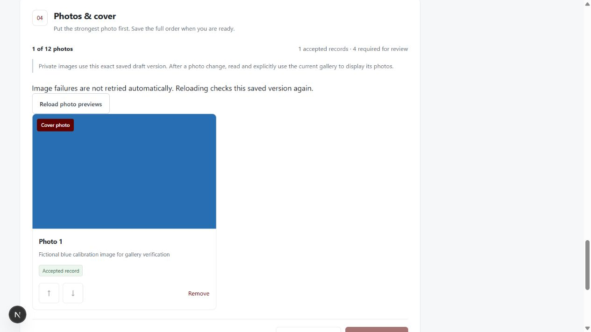
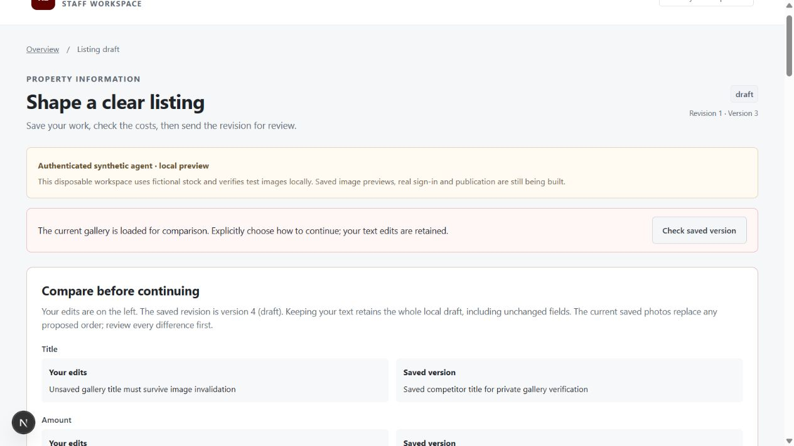
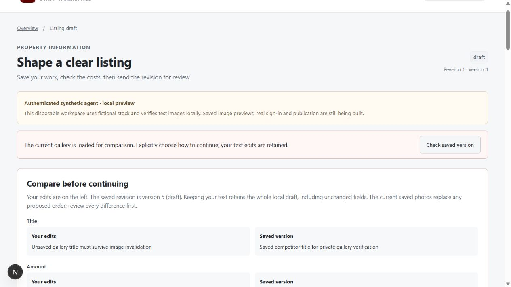

# Private saved gallery image evidence

12 October 2026, Africa/Nairobi. Owner: Boniface + Codex. Independently written replacement; synthetic data only. Original vendor resources/live applications and KES10,000 total monthly client-price baseline preserved.

## Executed frozen verification

- Complete actual build output: [gallery-images-build.txt](gallery-images-build.txt), exact raw package/API/admin-test-compile/admin-production bytes concatenated in that order; individual raw files below remain separate.
- Shared package builds: exit0. [2026-10-12-gallery-images-packages-build.txt](2026-10-12-gallery-images-packages-build.txt).
- API build: exit0. [2026-10-12-gallery-images-api-build.txt](2026-10-12-gallery-images-api-build.txt).
- Admin test-target compilation: exit0. [2026-10-12-gallery-images-admin-tests-compile.txt](2026-10-12-gallery-images-admin-tests-compile.txt).
- 703/703 combined affected tests; no failures/skips/cancellations/todos. Full TAP: [gallery-images-tests.txt](gallery-images-tests.txt); dated identical raw copy: [2026-10-12-gallery-images-tests.txt](2026-10-12-gallery-images-tests.txt).
- Admin production build: exit0. [2026-10-12-gallery-images-admin-build.txt](2026-10-12-gallery-images-admin-build.txt).
- All eight workspace typechecks: exit0. [gallery-images-types.txt](gallery-images-types.txt); dated identical raw copy: [2026-10-12-gallery-images-types.txt](2026-10-12-gallery-images-types.txt).
- 187 affected source hashes unchanged under the final verification runner and independently checked again before writing this checkpoint. Exact commands/hashes/times remain in rebuild-preservation/2026-10-12-source/verification-gallery-images-final-1.json.
- Every copied log and screenshot is byte-identical to its recorded source. Blank compiler output is retained as the exact raw file, not replaced with invented output.

Focused proxy verification first produced7pass/2fail in each of two attempts, then9pass in the subsequent focused run. Those initial failures are part of the checkpoint history, not current passes. The shared client focused preview/transport/upload/finalizer run passed61/61, including20 new preview cases. Focused proxy, SDK and model runs overlap the final combined run; do not add their counts. Earlier630 backend and627 admin-photo checks are separate prior checkpoints. This dated report uses only the completed final run for its combined count.

The first documentation-script execution stopped during preflight because the screenshot tool returned JPEG bytes under requested .png filenames. Its PNG-signature refusal occurred before any platform mutation. Original misnamed files were retained, and byte-identical .jpg companions are used with matching format signatures; no image conversion or raster editing occurred. The preparation failure is recorded in the archive gallery-images-docs-preflight-failure-note.json. This was an evidence-format correction, not a new browser or implementation test pass.

## What the code and test layers establish

The shared client sends a single exact authenticated bodyless GET and canonical saved-version header, preserves per-call identity and refuses redirects. Incremental response collection enforces declared/actual bounds through10MiB, exact image/webp and RIFF/WEBP framing, separately bounded safe error JSON, cancellation/deadline including body reads, and read-only errors without uncertainty or retries. Ordinary JSON transport and write semantics remain unchanged. Framing fixtures establish transport validation; they are not native decode or displayed-image proof.

The actual server-only helper/compiled Next route tests enforce default/production refusal, exact configured loopback Host/preview-instance/origin/fetch-site, strict resource/version and request selectors, no browser bearer/cookie/body/range/conditional/encoding forwarding, bounded reads, safe stale/denied failures and private/no-store/nosniff output. Browser Accept-Encoding is not forwarded. Only the configured server identity may reach the upstream API. No storage, worker, root or public image locator enters the browser URL.

Browser-model tests establish saved tuple/version eligibility, legacy/unaccepted no-read behavior, two-read batch admission, exact bounded response collection, obsolete-completion refusal, observed stale/denied batch invalidation, cancellation/URL cleanup, decode-failure release and explicit-only reload. Model doubles do not prove actual browser decoding or full product accessibility. The underlying API/SQL native/hash/provenance proof remains separately documented in the prior private-media-preview checkpoint; this feature does not weaken those gates.

## Actual desktop checks recorded by root

The following are copied from the completed gallery-images-browser-result.json. They are explicit executed checks; no missing browser result is converted into a pass.

- **Native upload and explicit saved-gallery adoption** — Actual desktop UI prepared, uploaded and verified the independently generated fictional 640x400 blue PNG, attached its original job to saved version2, read the gallery and explicitly adopted version3. Preparation/upload/attachment each received successful results; no retry/root replacement.
- **Decoded private saved photo** — Version3 displayed one accepted sealed cover with the supplied description. DOM image complete=true, naturalWidth640, naturalHeight400 and a blob:http://127.0.0.1:3001/ URL. Screenshot gallery-images-cover.jpg and gallery-images-displayed.dom.txt retain the actual visible state.
- **Competing edit clears stale previews** — Second tab saved title at version4. First tab retained its unsaved title and raw not-a-price; explicit Reload photo previews at version3 returned409 in actual Next terminal output. DOM then contained zero gallery image elements and disabled Save draft; Check saved version compared version4 without altering the raw strings. See gallery-images-stale-compare.dom.txt.
- **Explicit keep-text adoption restores current photo** — First tab chose Keep my text edits and use current photos, adopted version4, retained both raw values and displayed a newly decoded640x400 image with a different owned Blob URL. See gallery-images-adopted.dom.txt.
- **Removed association denies and clears images** — Second tab explicitly removed the photo, read the original applied result and adopted empty version5. First tab reloaded its version4 resource; actual Next terminal output showed404. DOM had zero gallery image elements, writes paused and both raw strings intact. Check saved version compared version5. See gallery-images-removed-compare.dom.txt.
- **Text validation and save remain separate** — First tab kept its text and adopted the empty version5 gallery. A separate Save draft rejected not-a-price with the positive-KES/two-decimal validation message, retained raw values and version5. Corrected21500.00 and explicitly saved; version6 read-back succeeded with the retained title and empty gallery. See gallery-images-invalid-price.dom.txt and gallery-images-final-save.dom.txt.
- **Owned preview stopped and roots retained** — Both agent-created QA tabs closed. Owned launcher stopped using Ctrl-C (terminal exit1 reflects interruption); subsequent native check showed zero port3001 listeners, no matching launcher/QA-root processes, and retained gallery-images-browser-root. No old root was reused or deleted.

## Actual browser screenshots

## Browser-specific limits

- Actual desktop in-app browser and local signed-identity/native synthetic preview only; not physical/narrow-device or operator UAT.
- Solid blue calibration image proves actual image decode/display, not property photography, visual design completion, Figma parity or accessibility acceptance.
- DOM shows current image elements and decoded dimensions; Blob revocation/cancellation/late completion correctness is separately covered by model tests, not browser instrumentation.
- Actual terminal status observations200/409/404 support the browser flow; no independent browser network capture or persistent raw launcher log is claimed.
- No continuous permission polling, simulated role revocation, refresh/crash recovery, CDN/public images, production identity/storage/PostgreSQL concurrency or launch acceptance checked.
- Synthetic state disappeared when the isolated preview stopped; retained native QA root remains evidence, not a production database backup.

## Remaining limits and next task

This remains local, synthetic and development-only. Production identity/provider/persistent composition, continuous authorization during network transmission, CDN/public delivery, global memory/concurrency quotas, retention/isolation, crash/all-store restart, real PostgreSQL concurrency, independent backup/private source remote, rights/accounts, physical/narrow devices, complete accessibility/operator UAT and all launch gates remain open. Delivered bytes cannot be remotely unseen; observed invalidation revokes owned URLs without claiming zero browser retention. No new provider or paid service was provisioned. Checklist13/97, accepted gates0/14; KES10,000 total monthly client price and vendor resources/live systems are preserved.

Next connect the staff enquiry inbox to admin assignment and assigned-agent contact with dated follow-up. Existing SQL capture/assignment/transitions are not a connected CRM: typed list/detail/commands, a narrow active-staff picker, legacy status convergence and original-command/uncertain-write recovery must be specified and verified before operational controls. Full viewing scheduling follows separately. The archive realtor-operations-next-step.md records the read-only scout.
