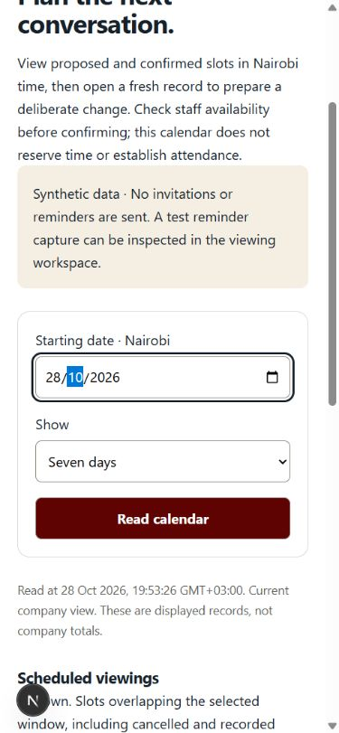
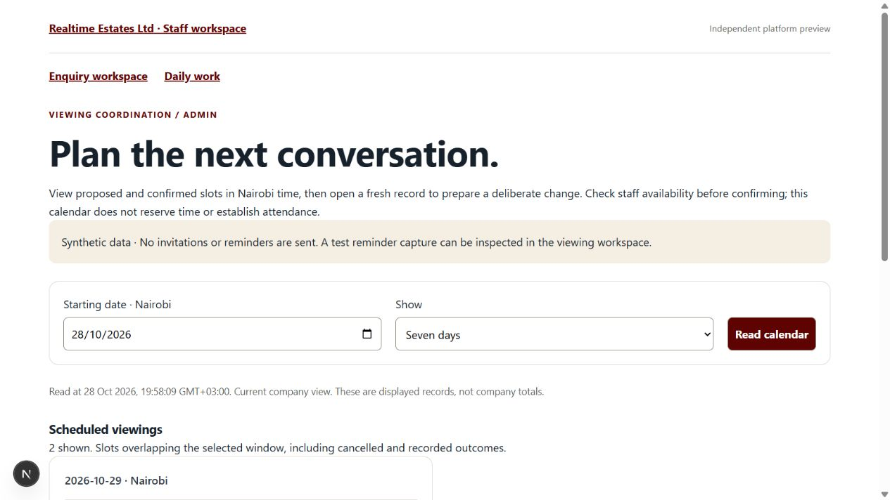

# Checkpoint214 — viewing calendar and current action links

28 October2026. Independent local code; synthetic data and ephemeral identities only. No vendor or old live resource was changed. Client recurring-price baseline remains KES10,000 per realtor/month.

## Delivered and accepted implementation

Task08-3 now has a bounded company/role-protected calendar alongside the existing request, proposal, phone-agreement, reschedule, decline, cancellation, explicit completion/no-show and retained-history lifecycle. Current admins see company work; agents see only enquiries currently assigned to them. Calendar links open a fresh authorized inspection without preparing or saving an operation. Nairobi date controls distinguish proposed appointments, confirmed slots, saved outcomes and unscheduled requests. Empty, unavailable and capped-result states are explicit. Calendar reads do not create audit entries or expose prospect contact/phone-agreement/notification-recipient data.

Notification failure visibility is honest: external delivery is unavailable in this local implementation. The existing optional synthetic capture-only path exposes uncertainty after a committed reply is lost and reads the original capture result without sending or automatically retrying. A capture record is never described as delivery. Provider integration, consent/cadence, external failure/reconciliation and operator/device acceptance remain open release work; AC-017 remains partial. This task acceptance is local implementation, not a production launch or completed end-to-end acceptance case.

## Executed verification

All logs are in [the retained evidence folder](2026-10-28-viewing-calendar/). Counts overlap and are not additive platform progress.

| Run | Actual result | Evidence |
| --- | --- | --- |
| Domain suite |299/299 pass,0fail/skip|domain-full-current.txt|
| API suite, fresh build included |301/301 pass,0fail/skip|api-full-current.txt|
| Shared client suite |303/303 pass,0fail/skip|sdk-full-current.txt|
| Admin boundary and UI suites |437+33 pass,0fail/skip|admin-tests.txt|
| Actual signed loopback HTTP suite |90/90 pass,0fail/skip|signed-http-full-current.txt|
| Full admin production build |passed including TypeScript, one worker|admin-build-current.txt|
| Focused domain/client/signed calendar |7/7 pass|focused-current.txt|
| Focused API/restricted SQL |4/4 pass|api-focused-corrected.txt|

Restricted SQL checks cover100 scheduled/25 requested limits and hasMore, half-open overlap, rescheduled slots, two companies, reassignment, revoked/customer/foreign denial, raw table denial, invalid windows, unchanged read audit and cleared transaction context. Historical owner-created test records deliberately represent past states; they do not claim valid execution of current commands in the past. The signed suite verifies the actual service/SDK/SQL path and immediate assignment changes.

The first focused signed run exposed the local preview's generic query guard rejecting calendar parameters. It was corrected only for the exact calendar route using the shared validator. Other retained failed focused runs exposed fixture version/type and verifier/missing-field mistakes; those fixtures were corrected without weakening assertions. Initial and corrected logs remain available.

## Actual desktop browser checks

Disposable preview, current API/SQL and synthetic actors; no physical Android/iOS device or external notification service. Retained DOM snapshots and the two inspected JPEGs are in the evidence folder.

1. A historical date range displayed the two historical fixture slots; the current week was initially empty. Opening viewing900 read version3 without a write.
2. An explicit fictional reschedule to29October12:00–13:00 Nairobi produced version4, shown as proposed/awaiting agreement. The earlier phone agreement was not reused. New fictional phone agreement produced version5, confirmed after an explicit fresh read.
3. Optional capture-only testing deliberately lost the first successful capture response. The UI showed uncertain, disabled clear, and recovered the original capture on explicit read. No provider/recipient or message was used.
4. Explicit fictional cancellation produced version6 and retained the cancelled slot. The history read displayed six saved states, including the earlier and rescheduled slots/agreements.
5. A new fictional request appeared in the unscheduled queue. Explicit first proposal moved it to the agenda and removed it from that queue without labelling it confirmed.
6. Admin reassignment of enquiry701 to the peer agent removed both current-week entries from the former agent's fresh calendar; admin retained both.
7. Invalid30February parameters displayed Calendar unavailable with no prior scheduled rows. Retry restored the current authorized range.
8. At390×844, client/scroll widths were375/375, cards stayed inside the viewport, controls had48px minimum height, and keyboard date-input focus was visible. At1280×900, client/scroll widths were1265/1265. These are desktop-browser viewport observations, not assistive-technology or physical-device acceptance.

The owned preview and browser tabs were stopped/closed after verification. The launcher's intentional Ctrl+C exit is not a test failure or graceful shutdown acceptance. No user browser notes/checklist edits were changed.

## Checkpoint and exact next work

38/97 canonical tasks complete (39%rounded);0/14 release gates. Eleven more whole tasks are needed to reach49/97 and cross50%. Do not reweight, split, remove or count deferred work to reach the target.

Next: persist this feature, refresh the maintained AC-017 evidence without marking the complete case passed, back up the local source and publish the existing owner-private dashboard. Then implement safe incomplete/expired media cleanup with authorization/reference protection and meaningful failure/recovery tests, followed by the remaining image-backed boundary/recovery browser matrix. Production identity/provider services, rights/accounts, devices, operator UAT, off-device restore and cutover remain open. No GitHub push or Actions rerun while quota is exhausted; no purchased credits/reset or account-plan change. Owner:Boniface+Codex.
